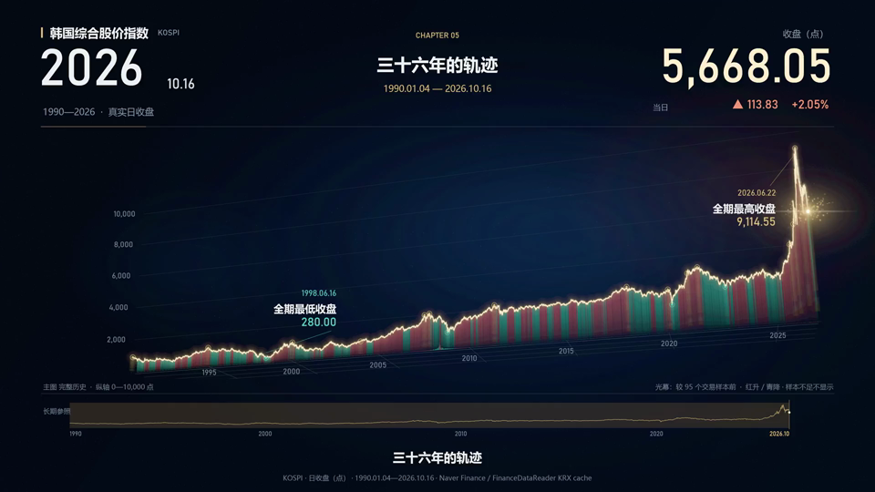
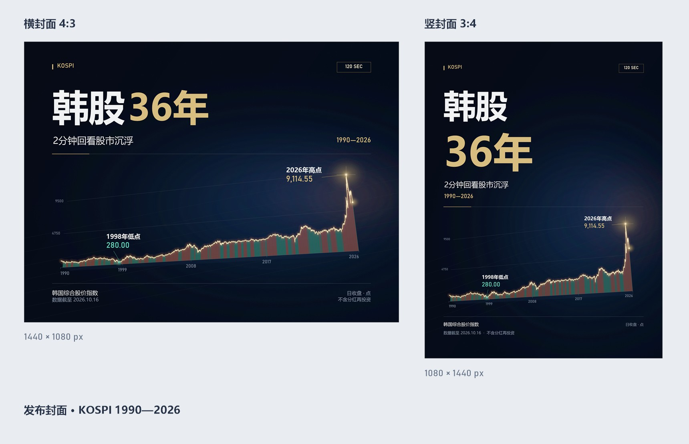
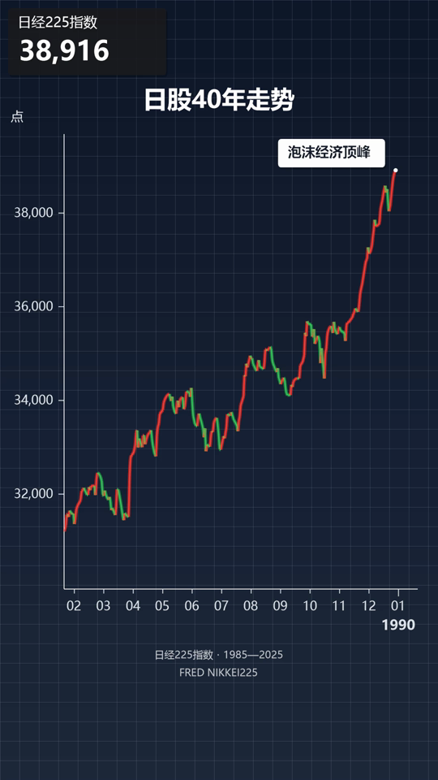
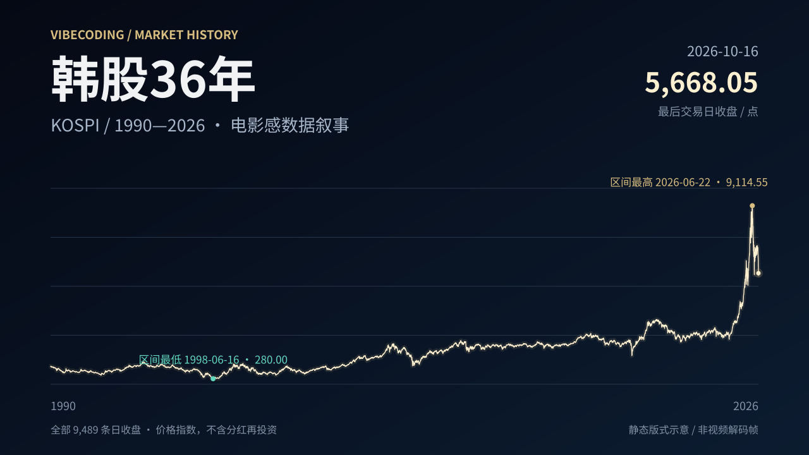
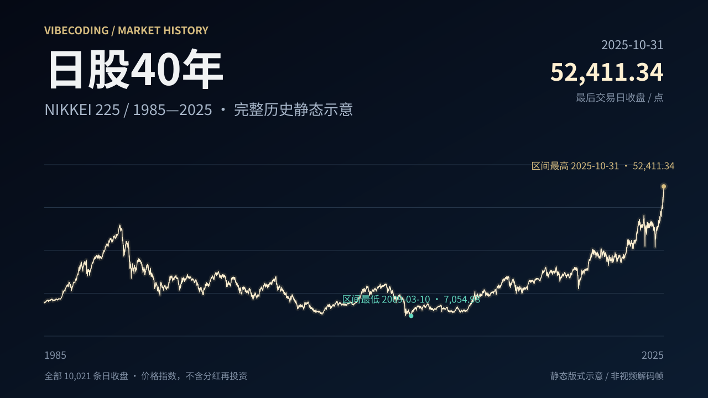

# vibecoding_stocks

把一份真实日线，做成有叙事、有节奏的历史走势视频。这里保存两次实际制作留下的代码、配置、配乐源码、封面工具和中文工作模板。

先原样跑通示例，再复制项目、替换行情和文案。改标的用配置，渲染和数据检查用同一套入口。

通用工具已完成韩股 120 秒、日股 220 秒完整重制的技术验收，也完成了两套 CPU 短预览、四张封面及真实第三标的替换验证。细项与观看、试听的实际范围见[实际复现记录](docs/validation.md)；[原工程的验证范围](docs/visual-spec.md)另行说明。

| 预设 | 示例 | 成片规格 | 声音 |
| --- | --- | --- | --- |
| `cinematic120` | 韩国 KOSPI，1990—2026 | 1920×1080、30 fps、120 秒 | 原创数学合成配乐、事件音效，无旁白 |
| `classic220` | 日经225，1985—2025 | 1080×1920、30 fps、220 秒 | 静音，可复现旧版讲述链路 |



*韩股片尾预览解码帧：119.9667 秒，CPU 短编码后实际解码，展示完整区间及高点后的回落。该图片来自发布版配置的片尾回归，不是完整 MP4 的解码帧。*

## Mac 与项目规范

Mac 原生渲染现使用 **.NET 8 + SkiaSharp**，安装和命令见 [Mac 指南](docs/mac.md)。支持两套模板、封面、低清预览及校验后分段续跑；实际检查范围以 [验证记录](docs/validation.md) 为准。Mac 无需 PowerShell。

开发与 AI 协作先阅读 [AGENTS.md](AGENTS.md)，它同时是自动发现入口和完整项目规范，包含后续 Windows 本地 AI 歌曲生成方案。制作工作流可整理成个人 `stock-video-production` Skill；个人 Skill 不随仓库自动安装。当前仍保留两套固定时间轴，未实现任意时长或可视化编辑器。

## Windows 五分钟上手

需要 **Windows、PowerShell 7、Python 3.11+、FFmpeg**，以及 Windows 的微软雅黑、Bahnschrift 字体。FFmpeg 需含 `libx264` 和 AAC，并安装同包的 FFprobe；无需 NVIDIA 显卡。工具会实际检测 NVENC 编码能力，`auto` 不可用时使用 CPU。

下载仓库后，在仓库根目录打开 PowerShell 7：

```powershell
python -m venv .venv
.\.venv\Scripts\python.exe -m pip install -r requirements.txt
.\.venv\Scripts\python.exe tools/stock_video.py doctor
.\.venv\Scripts\python.exe tools/stock_video.py init --preset cinematic120 --output projects/my_video
.\.venv\Scripts\python.exe tools/stock_video.py preview --project projects/my_video/project.json --seconds 5 --encoder libx264
.\.venv\Scripts\python.exe tools/stock_video.py covers --project projects/my_video/project.json
```

`init` 复制一套完整真实示例和 CSV。预览成功后，制作完整视频与审阅材料：

```powershell
.\.venv\Scripts\python.exe tools/stock_video.py build --project projects/my_video/project.json --workers 3
.\.venv\Scripts\python.exe tools/stock_video.py verify --project projects/my_video/project.json
```

结果默认写入项目旁的 `output/`。渲染命令可用 `--output` 指定其他输出目录。`--project` 路径相对当前工作目录；配置里的相对文件路径相对 `project.json` 所在目录。完整视频逐帧绘制，耗时取决于 CPU、分辨率和并发数；五分钟用于跑通操作，不是全片耗时承诺。

FFmpeg 不在 PATH 时可设置 `$env:FFMPEG_BIN = 'C:\Tools\ffmpeg\bin\ffmpeg.exe'`，或在预览、制作、验收和环境检查命令中传 `--ffmpeg`。无需把 FFmpeg 复制进仓库。完整安装与日股示例见[快速开始](docs/quickstart.md)。

## 换成你的标的

1. 复制预设后，将 `daily.csv` 替换为日期升序、日期不重复的 `date,close` 日线。
2. 修改 `project.json` 中的名称、代码、单位、来源、事件日期、章节、字幕、比较基准和发布文案；事件价格由 CSV 计算。
3. 保留所选预设的画幅、时长和分镜时间槽，先看预览和关键帧，再制作完整片。
4. 检查完整区间、极值、最后一个事件、片尾与声音；封面另生成 4:3 与 3:4 两版。

详细字段与迁移清单见[新项目指南](docs/new-project.md)，先填写[项目制作单](templates/production-template.md)，也可以使用[给 AI 的新项目提示词](templates/ai-new-project.md)。首版固定两套节奏，不提供任意时长或任意视频画幅。

电影感预设保留 `E01`—`E04` 分镜节点 ID；替换它们的交易日和文案，并保留现有到达与停留节奏。章节、字幕、来源和封面需要一起修改。



*同一份真实日线生成两种独立排版，正式输出为 1440×1080 与 1080×1440 PNG；此处为对照预览。*

## 这里保留了什么

- `tools/`：统一命令入口、渲染、音频合成、封面、数据与成片检查。
- `examples/`：两份真实 CSV、可编辑项目配置和来源记录；初次运行无需联网下载行情。
- `templates/`：项目填写表、事实审核、分镜、音频与发布模板。
- `docs/`：[两次制作复盘](docs/production-lessons.md)、[视觉规范与验证状态](docs/visual-spec.md)、[常见问题](docs/faq.md)。



*日股 CPU 预览解码帧：29.6 秒，展示 `classic220` 竖屏讲述画面。完整重制的技术验收与关键画面审阅见[实际复现记录](docs/validation.md)。*

## 完整历史曲线参考





*两张 SVG 根据完整真实 CSV 重绘，用于查看全历史数据与版式，不是视频解码帧。日股新版横屏“清晰讲述”风格仅有静帧验证，不能与 `classic220` 旧版竖屏视频混称。*

## 数据与授权

原创代码、文档、视觉源码及韩股配乐合成源码采用 [MIT](LICENSE)。示例行情保留 [Naver / FinanceDataReader 来源](examples/kospi/sources.json)与 [FRED NIKKEI225 来源](examples/nikkei/sources.json)，第三方数据权利不随 MIT 授权转移，适用条件见 [THIRD_PARTY_NOTICES.md](THIRD_PARTY_NOTICES.md)。系统字体、第三方录屏、外部音乐和完整成片不随仓库分发。

示例展示日收盘价格指数，不含分红再投资。事件背景与行情变化分别陈述；动画中的连续游标不是新增真实报价。音频验收记录只证明已做的技术检查，发布前仍应在本机播放器完整观看、试听。

日经 Mac 分支另有[激情配乐配置](docs/energetic-score.md)：`examples/nikkei/project-energetic.json`，加入原创 140 BPM 电子配乐和事件音效。原日经配置继续为静音；两者均为 220 秒。
