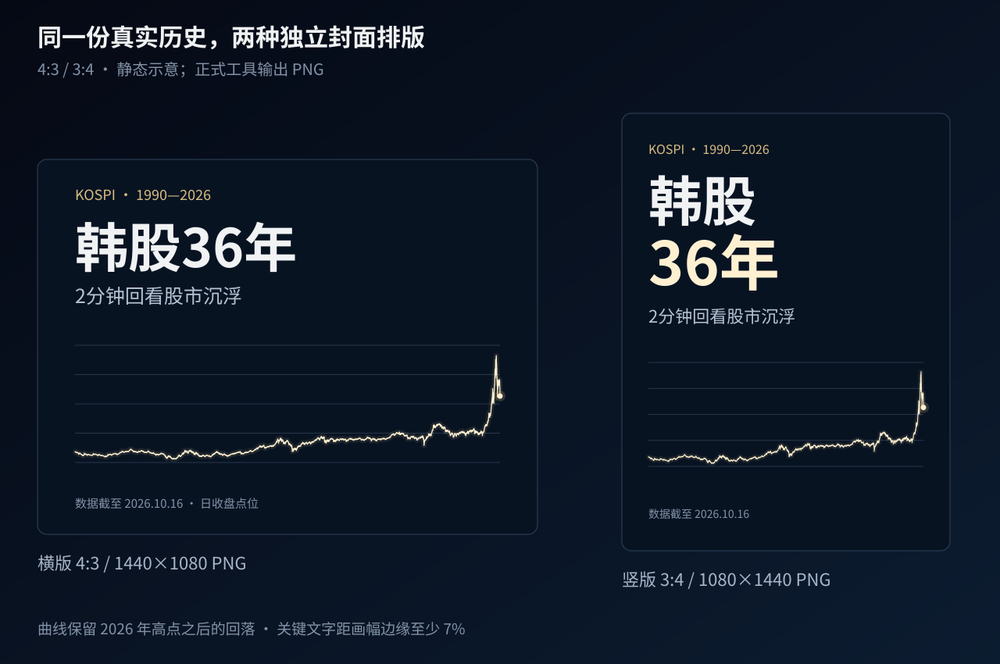

# 视觉规范与验证状态

## 原工程的验证范围

| 方案 | 原工程参考与状态 | 本仓库入口 |
| --- | --- | --- |
| 日股旧版竖屏讲述 | 220 秒完整静音视频已有工程与成片；红涨绿跌、事件气泡、约 12 个月移动视窗 | `classic220` |
| 日股新版清晰讲述 | 1920×1080 横屏静帧通过；该新版动画、配乐未验证 | 视觉规范参考，不作为完整视频预设 |
| 日股新版电影感 | 横屏静帧通过，是韩股视觉的前期参考 | 视觉规范参考 |
| 韩股电影感 | 120 秒完整有声工程、编码后关键帧与技术核验已保存；主观观看与听感需单独审阅 | `cinematic120` |

本表描述整理模板之前的原工程。整理后的通用工具已完成韩股 120 秒有声全片（17/17）和日股 220 秒静音全片（12/12）的技术验收，以及两套 CPU 短预览、四张封面、输入单测和真实第三标的替换，详见[实际复现记录](validation.md)。技术核验与关键画面审阅、连续观看、主观试听分别记录，未记录的项目视为待验。

验证状态不自动继承到新标的。更换长名称、大数值、事件密度或数据区间后，需要重新检查布局与全片。

## 电影感的画面约定

背景深蓝黑 `#050914`，金色 `#D7BD80`、暖白 `#FFF0D1` 主线，正文白 `#F0F2F3`，辅助灰蓝 `#8392A7`，低点青色 `#61D7BE`。曲线优先于网格、粒子与光幕，数字和标签优先于装饰。主图区采用固定透视；文字、顶部信息和长期小图保持平面。

横屏基准以 1920×1080 为单位：左右留约 90 px，顶部信息区与主图分开；标的名、当前日期和点位占最高信息层级，章节次之，底部保留一句字幕和数据说明。标签使用 Windows 微软雅黑，数字和英文优先 Bahnschrift。字号随画布统一缩放，长标签先改写再缩字。Mac 的 Skia 后端默认使用 PingFang SC、Helvetica Neue 和缺字回退；字体配置见 [Mac 指南](mac.md)。更换字体后必须重新测量布局，不要求与 GDI+ 像素完全相同。

电影感红青光幕表达阶段方向：当前收盘与 `phase_lookback` 个交易样本之前比较，韩股示例为 95；上涨或持平用红，下降用青，不足样本时不显示。它不是成交量、概率或日涨跌颜色，画面说明应保留此含义。主线始终金白，不按日线涨跌着色。

数据线、参考线、节点与底板使用同一投影；粒子和光晕不得形成另一条可误认的走势。低点、突破只强调颜色与数值，不改真实价格几何。最终最低、最高、首尾和比较百分比由当期 CSV 核对。

## 清晰讲述的画面约定

新版清晰讲述采用平面真实坐标、少量纵轴刻度、旧高细虚线和金白主线，保留当前节点、全量长期小图和一句字幕。与电影感版比较时，使用相同数据、日期、节点与字幕，只改变表达方式。这套新版目前仅有静帧验证；`classic220` 则是另一套已经完整制作过的竖屏旧版。

## 封面与缩略图

| 封面 | 最终 PNG | 排版 |
| --- | --- | --- |
| 横版 4:3 | 1440×1080 | 标题在上、全区间图表在下 |
| 竖版 3:4 | 1080×1440 | 主标题分两行，重新安排图表与注释 |

关键文字距边至少留 7%，主标题缩至 25% 后仍能认读。底部注明截止日，完整曲线保留高点后的回落。封面根据 `publishing` 文案生成，不直接裁切视频正文。单张图片以不超过 5 MB 为目标。

*图库封面是依据示例 CSV 绘制的 SVG 排版示意；正式 `covers` 命令输出 PNG。*

## 逐项目视检查

检查原尺寸与缩图：日期和主点位可读、长名称不遮字、事件标签不挡主线、光晕未淹没局部波动、暗部无明显色带。动画另看事件到达前后、镜头过渡、分段连接、全景片尾；静帧通过不等于运动通过。声音另做全程试听。

## Mac 分支竖屏视觉升级

当前 classic220 的共享渲染器已采用金白主线、柔和面积、完整日期与精确报价、事件圆环与独立卡片，以及全历史导航。表内“红涨绿跌”描述的是原工程，不再代表当前渲染器。时长、事件槽位、静音和数据契约不变；实现取舍及调研来源见 [动效改版](motion-design.md)。

随后按用户要求，classic220 主图改为累计历史：左端固定在起始月，横轴逐步扩展，历史走势持续压缩并保留；纵轴覆盖全部已出现行情。底部导航亮区代表已播放区间。最后两秒保持同一坐标逻辑及全历史，不再切换镜头。详见动效改版文档的累计压缩修订。
